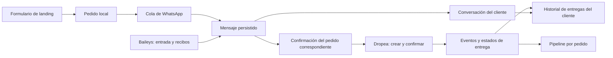

# Conversaciones, pipeline y Clientes para CRM Dropea

Revisión: 8 de noviembre de 2026, America/Santiago.

## Recomendación

Usar **Vocero CRM como referencia principal de interfaz y modelo de trazabilidad**:
bandeja de conversaciones, estados de mensaje, notas, intervención humana,
actualizaciones en tiempo real e historial de cambios de etapa.

Adaptar esas piezas dentro de CRM Dropea, conservando su conexión Baileys por QR,
su recepción de pedidos y su integración con Dropea. Instalar Vocero completo como
otra aplicación introduciría otro backend, autenticación, base de datos y motor
de estados que habría que mantener sincronizados.

BotBgital aporta referencias para atención humana, tickets y flujos de soporte.
Es una referencia secundaria para este objetivo: su implementación revisada no
ofrece el mismo seguimiento de recibos ni el pipeline visual de Vocero.

Esto es un análisis estático de código y contratos. No se instalaron dependencias,
ejecutaron los proyectos, enviaron mensajes ni cambiaron servicios de producción.
La existencia de código y pruebas en un repositorio no demuestra que todas sus
funciones estén verificadas en nuestro entorno.

## Qué se revisó

| Proyecto | Commit revisado | Fecha del commit | Tecnología observada |
|---|---|---|---|
| Vocero CRM | `b29900d34668533d7f22ee7ebb8c3eb099c36bef` | 2 de noviembre de 2026 | Next.js 15, React 19, PostgreSQL, Drizzle, WhatsApp Cloud API |
| BotBgital | `01674091e6c31b5cf90c78d3186313536915b5b6` | 12 de marzo de 2026 | Laravel 12, PHP 8.2+, React 19, Eloquent, WhatsApp Cloud API |
| CRM Dropea actual | Código local de `server/` y `src/` | Revisión de esta sesión | Express, React, SQLite y Baileys con QR |
| Contrato Dropea | OpenAPI descargado nuevamente | 8 de noviembre de 2026 | API dropshipper y eventos de pedidos |

En BotBgital el README menciona Laravel 11 y React 18, pero los manifiestos
declaran Laravel 12 y React 19. La comparación anterior usa los manifiestos.

## Comparación de capacidades observadas

| Necesidad | Vocero | BotBgital | Implicación para nuestro CRM |
|---|---|---|---|
| Bandeja visual | Lista, hilo y panel de contacto; respuestas y adjuntos | Conversaciones, historial y envío de texto por agente | Vocero es la referencia más completa |
| Mensajes enviados/entregados/leídos | Estado persistido, actualización de recibos e identificación única del mensaje | Guarda contenido e ID de Meta; el webhook revisado descarta actualizaciones que no contienen mensajes | Hay que instrumentar nuestros eventos de Baileys |
| Lectura por el comprador | Se procesa el estado del proveedor | `read_at` se actualiza al marcar entrantes leídos desde el panel | No confundir lectura del operador con lectura del cliente |
| Actualización visual | Eventos SSE y publicaciones por organización | Consulta de conversaciones cada 10 s e hilo cada 5 s | Preferir persistencia + SSE, con recuperación tras reconexión |
| Pipeline | Kanban editable y bitácora de movimientos | Lista de prospectos con estados editables | Adaptar Kanban a pedidos y logística |
| Auditoría de etapas | Tabla histórica y cambio de estado dentro de una misma transacción | No identifiqué una bitácora equivalente en los archivos revisados | Registrar cada transición, no solo la última |
| Automatización existente | API de servicio y traspaso al humano | Motor de flujos y pausa cuando toma un agente | Conservar nuestra automatización y añadir intervención controlada |
| Conexión WhatsApp | Meta Cloud API | Meta Cloud API | Ninguno reemplaza directamente nuestro QR Baileys |
| Entregas físicas y transportistas | No encontré integración Dropea ni métricas logísticas de este tipo | No encontré integración Dropea ni métricas logísticas de este tipo | Esta parte se construye con Dropea y sus eventos |

### Dos diferencias que impiden copiarlo directamente

1. **Canal de WhatsApp:** los dos repositorios envían mediante Meta. Para mantener
   el QR necesitamos un adaptador Baileys que guarde los mismos conceptos de
   conversación, mensaje y recibo. Sus pantallas y modelos son referencias, no
   conectores Baileys listos para instalar.
2. **Entidad del pipeline:** Vocero impone un lead por contacto. Nosotros necesitamos
   varios pedidos por cliente, posiblemente en distintos países. Un cliente puede
   tener una compra entregada y otra esperando confirmación. Cada tarjeta de
   logística debe representar un pedido; la ficha de cliente reúne su historial.

### Aspectos a revisar antes de reutilizar código

- Vocero incluye un archivo LICENSE MIT. Si se reutilizan partes, conservar su
  atribución y revisar las dependencias que realmente se incorporen.
- BotBgital declara MIT en `composer.json`; no encontré un LICENSE en la raíz
  del árbol revisado. Conviene aclarar la licencia del código propio antes de copiarlo.
- El webhook de BotBgital revisado registra cargas completas y escribe el token
  esperado durante fallos de verificación. No observé validación de firma HMAC
  del POST en ese controlador. Estas implementaciones requieren revisión antes
  de usarlas con conversaciones reales; no es una auditoría completa del proyecto.
- BotBgital permite guardar una salida aun si el servicio devuelve `null`; no hay
  en ese flujo un estado explícito de envío fallido equivalente al de Vocero.

## Qué falta hoy en CRM Dropea

La integración actual cumple la confirmación automática, pero conserva muy poco
para construir una bandeja de atención:

- `server/whatsapp.js` atiende mensajes nuevos de texto y deriva la respuesta al
  flujo de confirmación. Omite mensajes propios, no registra el hilo completo,
  desactiva la sincronización de historial y no consume estados de mensajes.
- `landing_orders` guarda el teléfono, estado actual e IDs de entrada y salida;
  no es un archivo completo de la conversación.
- `landing_inbound` evita reprocesar ciertos mensajes de confirmación; no almacena
  todos los textos recibidos, preguntas o archivos.
- `resources` conserva la última representación del pedido de Dropea.
- `events` deduplica webhooks y conserva referencia y hora de recepción. No guarda
  cada payload, el estado anterior, el nuevo ni la hora original del evento como
  una cronología consultable.

Por eso una pantalla de chat por sí sola no resuelve la trazabilidad. Primero hay
que guardar los hechos que luego mostrará esa pantalla. Los mensajes que nunca
se almacenaron no pueden reconstruirse con certeza a partir del estado actual.
Una futura importación de historial depende de lo que sincronice el dispositivo
vinculado; no debe prometer recuperar todo el pasado.

## Diseño recomendado dentro de la plataforma

### Conversaciones

Bandeja con tres zonas: conversaciones a la izquierda, mensajes al centro y ficha
del cliente con sus pedidos a la derecha. Mostrar texto, hora, origen automático
o humano, estado del mensaje, errores y pedido relacionado cuando se conozca.
No asignar automáticamente toda pregunta a una compra si existen varias posibles.

Guardar el mensaje antes de enviarlo; después enlazar su ID de WhatsApp. Registrar
también intentos y resultados de envío, mensajes recibidos, citas y, cuando estén
disponibles, recibos de entrega/lectura. Actualizar la bandeja después del commit
de la base de datos. Al reconectar, consultar los datos persistidos, no confiar
solamente en eventos temporales del navegador.

Baileys expone `messages.upsert`, `messages.update` y `message-receipt.update`.
Se debe normalizar cada evento, deduplicarlo y conservar la identificación de la
cuenta/canal y del mensaje. Un recibo ausente significa «no informado», no «leído».
Los mensajes escritos desde el teléfono también deben registrarse cuando el canal
los notifique, sin disparar confirmaciones como si fueran respuestas del comprador.

### Pipeline de pedidos

Recibido → Esperando confirmación → Cliente confirmó → Confirmado en Dropea →
Preparación → En tránsito → En reparto → Entregado.

Ramas: requiere atención, incidencia, rechazado, cancelado, vencido y devuelto
cuando la fuente proporcione ese estado. Conservar junto al estado visual el
`status` y `sub_status` exactos del proveedor para no perder detalle.

Los estados de logística provienen de Dropea. Una intervención humana puede
agregar una nota o resolver una tarea; arrastrar una tarjeta no debe declarar
«Entregado» en sustitución del transportista ni enviar órdenes accidentalmente.
Las excepciones no son una escala lineal: pueden resolverse y volver a reparto.

Registrar los cambios de estado como eventos permanentes con origen, hora de
ocurrencia, hora de recepción e identificador del proveedor. Mantener deduplicación
y proteger la proyección actual frente a eventos atrasados. La bitácora puede
conservar un evento histórico sin hacer retroceder el estado vigente.

**Tres estados distintos:** mensaje entregado en WhatsApp; pedido confirmado por
el cliente; paquete entregado físicamente. Ninguno demuestra por sí solo los otros.

### Clientes

Ficha con nombre, teléfonos, país, conversaciones, compras, productos, estados,
incidencias, fechas y seguimiento. Mantener el cliente aunque termine la asociación
de confirmación de un pedido: lo que se cierra es esa asociación, no su historial.

Modelo mínimo propuesto:

- Cliente: workspace + teléfono internacional normalizado, con correcciones de
  identidad explícitas. No unir personas solo por nombres parecidos.
- Conversación: workspace + cuenta de WhatsApp + identidad del chat.
- Pedido: referencia local y referencia Dropea por cuenta/país. El número `#123`
  puede existir en dos países y no representa el mismo pedido.
- Mensaje, recibos y eventos del pedido: relaciones a conversación/cliente/pedido,
  con IDs externos únicos dentro de su origen y contenido histórico persistido.

El workspace actual no proporciona cuentas independientes para una comunidad.
Esa separación requerirá su propio diseño de acceso antes de compartir instancias
entre negocios.

## Datos de entrega que realmente podemos obtener

### Confiabilidad ya disponible en Dropea

La especificación consultada documenta:

`GET /dropshipper/orders?include=reliability`

El pedido puede traer `customer_reliability` con `delivery_rate`, `delivered_count`,
`rejected_count`, `total_computable` y `level`. La tasa documentada es
`entregados / (entregados + rechazados)`; `null` significa que aún no es calculable.
Se devuelve de forma opcional y puede faltar si el teléfono no tiene historial
resoluble.

Es un historial por teléfono calculado **en toda la plataforma Dropea**, no solo
en nuestras ventas. La ficha debería distinguir claramente:

- «Historial en tu negocio»: calculado con nuestros pedidos y fechas.
- «Confiabilidad reportada por Dropea»: dato externo, mostrando sus conteos y
  momento de consulta. No mezclar ambos conjuntos ni sumar sus contadores.

### Propuesta de indicadores propios

| Indicador | Fuente y regla | Límite importante |
|---|---|---|
| Pedidos entregados/no entregados | Estados finales y subestados de Dropea | Separar rechazo del comprador, cancelación previa al despacho y fallo logístico |
| Porcentaje de entrega operativo | Entregados / envíos con resultado final conocido | Excluir pedidos en curso y cancelaciones antes de despacho; mostrar tamaño de muestra |
| Tiempo desde compra hasta entrega | `delivered_at` − fecha de recepción del formulario | Usar solo pares válidos, sin sustituir datos faltantes por cero |
| Tiempo desde confirmación en Dropea | `delivered_at` − `confirmed_at` | Es otra duración, debe tener su propio nombre |
| Tiempo desde despacho | Entrega − fecha fiable de despacho | Hay que guardar el evento de salida o integrar tracking; `updated_at` no equivale a despacho |
| Entregado al primer intento | Registro completo de intentos del transportista | No puede inferirse por ausencia de incidencias en nuestra copia |
| Intento fallido observado | Evento/subestado `DELIVERY_ATTEMPTED` | No garantiza el número total de intentos ni su secuencia completa |

El contrato actual incluye `confirmed_at`, `processing_at`, `delivered_at`,
`tracking_number` y `tracking_url`; no encontré un endpoint documentado para
historial completo de intentos ni un contador explícito de intentos. Los cambios
de estado llegan por `order.status.changed`, con `event_id`, `event_at` y el pedido.

Para primera entrega y número de intentos habrá que comprobar una fuente del
transportista o una ampliación de Dropea. Mientras tanto debe verse **«Sin dato»**.
Un historial incompleto o el inicio tardío del seguimiento no son prueba de que
el comprador recibió al primer intento. Evitar convertir fallos logísticos en una
calificación negativa automática del cliente.

## Orden de implementación propuesto

1. **Base de trazabilidad:** persistir mensajes y recibos; bitácora de estados de
   pedidos; enlace estable cliente–conversación–pedidos. Probar duplicados,
   reconexiones, eventos tardíos y compras simultáneas del mismo teléfono.
2. **Conversaciones:** bandeja integrada al CRM, estados visibles, notas y
   respuesta humana con control de la automatización por pedido.
3. **Pipeline:** columnas automáticas por pedido, filtros de país/tienda y acceso
   al chat desde cada tarjeta. Los fallos de envío o de Dropea crean tareas visibles.
4. **Clientes:** historial consolidado, confiabilidad de Dropea separada de
   indicadores propios, duraciones y datos de intentos solamente cuando existan.

La recomendación no implica instalar un segundo CRM ni activar un agente de IA.
La confirmación automática existente se conserva como motor de negocio; la
trazabilidad y la atención humana se agregan alrededor de ese flujo.

## Evidencias principales

- [Vocero: manifiesto y dependencias](https://github.com/kevinrivm/vocero-crm/blob/b29900d34668533d7f22ee7ebb8c3eb099c36bef/package.json).
- [Vocero: tablas de conversaciones, mensajes, pipeline e historial](https://github.com/kevinrivm/vocero-crm/blob/b29900d34668533d7f22ee7ebb8c3eb099c36bef/src/lib/db/schema.ts).
- [Vocero: actualización de estados de mensaje](https://github.com/kevinrivm/vocero-crm/blob/b29900d34668533d7f22ee7ebb8c3eb099c36bef/src/server/inbox/status.ts).
- [Vocero: cambio de etapa e historial en una transacción](https://github.com/kevinrivm/vocero-crm/blob/b29900d34668533d7f22ee7ebb8c3eb099c36bef/src/server/leads/stage-history.ts).
- [Vocero: bandeja](https://github.com/kevinrivm/vocero-crm/blob/b29900d34668533d7f22ee7ebb8c3eb099c36bef/src/components/inbox/inbox-client.tsx), [pipeline](https://github.com/kevinrivm/vocero-crm/blob/b29900d34668533d7f22ee7ebb8c3eb099c36bef/src/components/pipeline/pipeline-client.tsx) y [eventos SSE](https://github.com/kevinrivm/vocero-crm/blob/b29900d34668533d7f22ee7ebb8c3eb099c36bef/src/server/events/bus.ts).
- [Vocero: licencia](https://github.com/kevinrivm/vocero-crm/blob/b29900d34668533d7f22ee7ebb8c3eb099c36bef/LICENSE).
- [BotBgital: backend real](https://github.com/alvarobgital/BotBgital/blob/01674091e6c31b5cf90c78d3186313536915b5b6/composer.json) y [frontend real](https://github.com/alvarobgital/BotBgital/blob/01674091e6c31b5cf90c78d3186313536915b5b6/package.json).
- [BotBgital: webhook](https://github.com/alvarobgital/BotBgital/blob/01674091e6c31b5cf90c78d3186313536915b5b6/app/Http/Controllers/Api/WhatsAppWebhookController.php).
- [BotBgital: mensajes y lectura del operador](https://github.com/alvarobgital/BotBgital/blob/01674091e6c31b5cf90c78d3186313536915b5b6/app/Http/Controllers/Panel/MessageController.php).
- [BotBgital: interfaz de conversaciones](https://github.com/alvarobgital/BotBgital/blob/01674091e6c31b5cf90c78d3186313536915b5b6/resources/js/Pages/Conversations.jsx) y [estados de prospectos](https://github.com/alvarobgital/BotBgital/blob/01674091e6c31b5cf90c78d3186313536915b5b6/app/Http/Controllers/Panel/SalesLeadController.php).
- [Baileys: eventos de mensajes y recibos](https://github.com/WhiskeySockets/baileys.wiki-site/blob/main/docs/socket/receiving-updates.md).
- [Dropea: contrato OpenAPI consultado](https://public-api.dropea.com/dropshipper/openapi.json). Copia local de revisión en `data/research/dropea-openapi-reviewed.json`.
